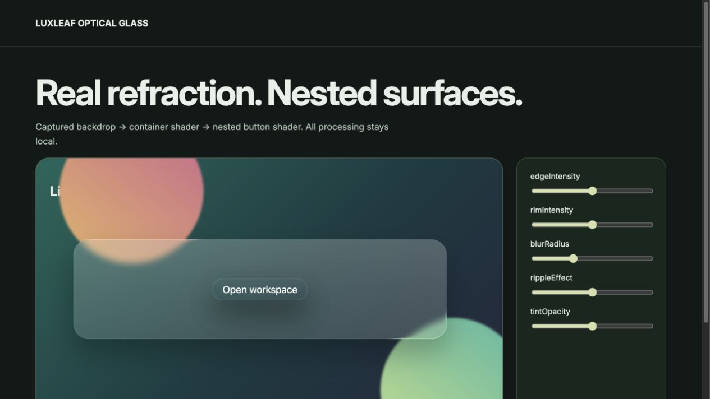

# LuxLeaf Glass UI

**Build glass panels and buttons, from React surfaces to nested WebGL refraction.**

[Quick start](#quick-start) · [Examples](#examples) · [API guide](#api-guide) · [Run the demos](#run-the-demos) · [Documentation](#documentation)



*Actual package workbench. [View its source](demo/advanced.tsx); run `/advanced.html` using the instructions below. This is a screenshot, not a hosted live demo.*

## At a glance

- React panels and buttons with tint, blur, shape and border controls.
- An optical Container/Button pipeline with real backdrop sampling and nested surfaces.
- Typed optical settings, keyboard interaction and disabled-state support.
- Explicit capture, context recovery and renderer cleanup.

**Release covered:** `@zontafor/luxleaf-glass-ui@0.2.1` on `main`. [PR #1](https://github.com/Zontafor/luxleaf-glass-ui/pull/1) contains newer work; its [source-branch guide](https://github.com/Zontafor/luxleaf-glass-ui/blob/faithful-upstream/LUXLEAF.md) uses the APIs available on that branch. The examples below use the published package, unless explicitly labeled otherwise.

## Quick start

Node 24+ for this repository; React 19 for React examples. The optical path requires WebGL and a captureable backdrop. The ordinary React components use CSS/SVG effects.

### Install in an application

Configure GitHub Packages authentication as described in the [release and registry guide](docs/RELEASING.md). Scope the registry to LuxLeaf so other dependencies continue to resolve from their normal registry:

```sh
npm config set @zontafor:registry https://npm.pkg.github.com --location=project
npm install @zontafor/luxleaf-glass-ui@0.2.1
```

Keep credentials outside committed source. [GitHub Releases](https://github.com/Zontafor/luxleaf-glass-ui/releases) also provide package archives; downloading an archive is separate from installing through the registry.

### Try the repository locally

```sh
git clone https://github.com/Zontafor/luxleaf-glass-ui.git
cd luxleaf-glass-ui
npm ci --ignore-scripts
npm run build
npm run dev
```

Open the local address printed by Vite. React examples below belong in a React/TypeScript application; plain TypeScript examples run in a browser with a bundler.

## Examples

### React panel with an action

```tsx
import { useState } from 'react';
import { GlassPanel, GlassButton } from '@zontafor/luxleaf-glass-ui';

export function WorkspaceCard() {
  const [opened, setOpened] = useState(false);
  return (
    <section style={{ padding: 40, background: 'linear-gradient(135deg, #174b47, #816b7f)' }}>
      <GlassPanel options={{ blur: 16, opacity: 0.2, radius: 24 }} style={{ padding: 28 }}>
        <h2>Your workspace</h2>
        <p role="status">{opened ? 'Workspace selected' : 'Ready when you are.'}</p>
        <GlassButton options={{ shape: 'pill' }} onClick={() => setOpened(true)}>
          Open workspace
        </GlassButton>
      </GlassPanel>
    </section>
  );
}
```

The panel and button inherit the backdrop beneath them. Native button semantics provide keyboard activation; use the normal `disabled` prop when needed.

### Nested optical glass

```ts
import { Container, Button, captureBackdrop } from '@zontafor/luxleaf-glass-ui/webgl';
import '@zontafor/luxleaf-glass-ui/webgl.css';

export async function mountOpticalPanel(stage: HTMLElement) {
  // Stage should already contain the backdrop you intend to capture.
  stage.style.position = 'relative';
  stage.style.minHeight = '280px';
  await captureBackdrop(stage);

  const panel = new Container({ borderRadius: 28, tintOpacity: 0.25 });
  panel.element.style.cssText += ';position:absolute;left:8%;top:60px;width:84%;height:160px';
  const button = new Button({
    text: 'Open workspace', type: 'pill', size: 18,
    onClick: () => console.info('Workspace selected'),
  });
  stage.append(panel.element);
  panel.addChild(button);
  panel.updateSizeFromDOM();
  panel.updateControls({ blurRadius: 7, edgeIntensity: 0.02 });

  return () => panel.destroy(); // Call when the view is removed.
}
```

Call `mountOpticalPanel(stage)` after the stage is mounted and its images/fonts have loaded. Capture a permitted, bounded element. The workbench demonstrates the required backdrop and layout.

### Enhance an existing element

```ts
import { mountGlass } from '@zontafor/luxleaf-glass-ui';

export function decorate(element: HTMLElement) {
  const glass = mountGlass(element, { shape: 'pill', blur: 12, opacity: 0.18 });
  glass.update({ tint: '#b7dba7', opacity: 0.25 });
  return () => glass.destroy(); // Restores the element's original inline style.
}
```

Use the DOM helper when a React component is unnecessary. This helper uses the CSS/SVG path, not the optical capture pipeline.

## API guide

| Entry or symbol | Purpose |
|---|---|
| `GlassPanel / GlassButton` | React components; common options plus standard DOM props. |
| `mountGlass(element, options)` | Returns update() and destroy() for an existing element. |
| `/webgl: Container / Button` | Nested optical surfaces with addChild(), updateControls() and destroy(). |
| `/webgl: captureBackdrop(root)` | Explicitly capture the chosen backdrop before mounting optical surfaces. |
| `/webgl.css` | Styles required by optical containers and buttons. |

### Common options

| Option | Default | Accepted values |
|---|---|---|
| `tint` | `#d7f0e1` | Six-digit hex color |
| `opacity / border` | `0.15 / 0.3` | 0–1 |
| `blur` | `12` | 0–30 pixels |
| `radius / refraction` | `24 / 8` | 0–100 / 0–30 |
| `shape` | `rounded` | rounded, pill, circle |

## Run the demos

After `npm run dev`, append a route below to the local Vite address. These links point to checked-in source; GitHub does not execute the demos itself.

| Local route | Example | Source |
|---|---|---|
| `/` | Compact example | [React entry](demo/main.tsx) |
| `/advanced.html` | Full workbench shown above | [Workbench](demo/advanced.tsx) |
| `/checks.html` | Base browser checks | [Check page](demo/checks.html) |
| `/checks-expanded.html` | Expanded browser checks | [Check page](demo/checks-expanded.html) |

## Development and verification

```sh
npm run verify          # Type checks, tests, build, and foundation checks where defined
npm run verify:package  # Inspect and import the built package archive
```

Open the browser check pages separately and use their Run button. [Validation notes](docs/VALIDATION.md) distinguish automated checks, browser observations and remaining host verification. Passing checks does not certify complete upstream or cross-device parity.

### Integration notes

Backdrop capture is not a confidentiality boundary; choose its root deliberately. CSS/SVG and optical options are different APIs. Cross-browser pixel equivalence and high surface-count performance are not certified.

## Documentation

| Guide | What it covers |
|---|---|
| [Capabilities](docs/CAPABILITIES.md) | Implemented features and current limits |
| [Architecture](docs/ARCHITECTURE.md) | Rendering, state and resource lifecycle |
| [Validation](docs/VALIDATION.md) | Checks and their scope |
| [Releases](docs/RELEASING.md) | Registry authentication, archives and release verification |
| [Provenance](docs/PROVENANCE.md) | Foundation boundaries and original additions |
| [Security](SECURITY.md) | Supported deployment assumptions |
| [Changelog](CHANGELOG.md) | Release history |

## License and attribution

Original LuxLeaf code, documentation and examples are covered by the [proprietary license](LICENSE), copyright **Michelle L. Wu**. Included third-party software retains its own licenses and authorship; see [third-party notices](THIRD_PARTY_NOTICES.md). Public repository visibility does not grant rights beyond those licenses.
