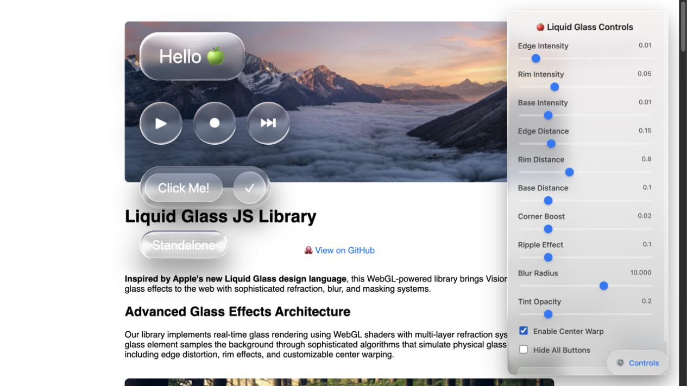

# LuxLeaf Glass UI — source guide

**Explore the original glass containers, buttons and nested optical rendering.**

[Quick start](#quick-start) · [Usage](#usage) · [Nested surfaces](#nested-surfaces) · [Controls](#controls) · [Verification](#verification)



*Actual local run of the restored demo. The original [README](UPSTREAM.md), [animated example](demo.gif) and MIT notices are retained.*

The complete pinned implementation is now on private `main`, with its original package names, source and license notices. The previously published `@zontafor/luxleaf-glass-ui` package is a separate earlier implementation; its [historical package guide](https://github.com/Zontafor/luxleaf-glass-ui/blob/8c3b9d6f2eec14eb27a4ae8b370fb89847387425/README.md) is preserved at that revision. This restoration does not publish a new registry package.

## Quick start

No package build is required for this original HTML/JavaScript demo.

```sh
git clone https://github.com/Zontafor/luxleaf-glass-ui.git
cd luxleaf-glass-ui
python3 -m http.server 8080 --bind 127.0.0.1
```

Open `http://localhost:8080`. Use a browser with WebGL. The original demo loads html2canvas and remote background images, so it is not an offline bundle.

## Usage

Create `example.html` at the repository root and open it through the same local server:

```html
<!doctype html>
<html lang="en">
<head>
  <meta charset="utf-8">
  <meta name="viewport" content="width=device-width, initial-scale=1">
  <title>Glass button example</title>
  <link rel="stylesheet" href="glass.css">
  <style>
    body { margin: 0; min-height: 100vh; display: grid; place-items: center;
      background: linear-gradient(135deg, #174b47, #8e7395); }
  </style>
</head>
<body>
  <script src="https://cdn.jsdelivr.net/npm/html2canvas@1.4.1/dist/html2canvas.min.js"></script>
  <script src="container.js"></script>
  <script src="button.js"></script>
  <script>
    const action = new Button({
      text: 'Open workspace', size: 24, type: 'pill', tintOpacity: 0.3,
      onClick: () => console.info('Workspace selected')
    });
    document.body.appendChild(action.element);
    action.updateSizeFromDOM();
  </script>
</body>
</html>
```

## Nested surfaces

Inside the same script-loading setup, create a panel and attach child buttons:

```js
const panel = new Container({ type: 'rounded', borderRadius: 24, tintOpacity: 0.3 });
panel.element.style.width = '320px';
panel.element.style.height = '160px';
document.body.appendChild(panel.element);
panel.addChild(new Button({ text: 'Play', size: 22, type: 'pill' }));
panel.addChild(new Button({ text: '✓', size: 22, type: 'circle' }));
panel.updateSizeFromDOM();
```

Children sample the parent container's rendered output. See [demo.js](demo.js) for the original page composition and [button.js](button.js) for nested button behavior. The source branch does not provide the additional cleanup and keyboard adapters found in the separate published LuxLeaf package.

## Controls

The original demo's control panel provides a direct way to inspect the effect:

| Control group | What changes |
|---|---|
| Edge, rim and base intensity | Refraction strength across the surface |
| Edge, rim and base distance | Falloff of those effects |
| Corner boost and ripple | Highlights and surface variation |
| Blur and tint opacity | Background softness and surface tint |
| Center warp | Distortion within the surface |
| Hide buttons / randomize | Composition and effect comparisons |

These demo controls are implemented in [controls.js](controls.js). The original [API reference](UPSTREAM.md#-api-reference) documents Container and Button options.

## Verification

```sh
node .luxleaf/verify-source.mjs
node --check container.js
node --check button.js
node --check controls.js
node --check demo.js
```

All 13 pinned source files pass the identity check. The original demo was opened locally and its warp and blur controls exercised. See [verification](.luxleaf/verification.json). This is not certification of every browser, layout or pixel output.

## Source and license

Pinned revision: `78cb6ccb0b9987bb60a88b14ccbd13a9e6e8ab2a`. [Source manifest](.luxleaf/upstream-manifest.json). The original [MIT license](LICENSE), authorship and source documentation remain in place.
