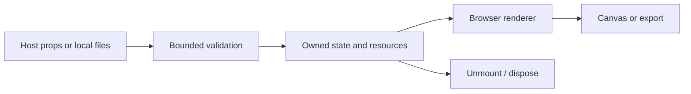

# Architecture — v0.2.1

### Optical foundation

The complete 13-file MIT reference is preserved. `/webgl` adapts its actual Container/Button shaders and parent-texture sampling; this is an optical renderer, not only CSS backdrop blur.

### LuxLeaf controls

Validated optical ranges, typed exports, a React adapter, keyboard interaction, disabled state, hierarchy cycle checks, explicit capture, context recovery and GPU/listener/timer disposal.

### Two rendering paths

The original CSS glass components remain available for ordinary UI. Optical surfaces use explicit permitted backdrop capture and exclude common editable/private elements.

### Remaining host verification

Backdrop capture is not a confidentiality boundary: the host must choose a permitted capture root. Cross-browser pixel equivalence, arbitrary nested reparenting and performance at high surface counts are not certified.

## Processing flow



## Foundation boundary

LuxLeaf extension code lives in `src/` and the adapted optical engine in `engine/`. Permitted reference source is preserved separately where included. Host-specific adapters are separate entry points. The browser library does not supply application-wide authorization or tenant isolation.

## Earlier core design notes

# LuxLeaf Glass UI: architecture

```text
React props or imperative mount → strict preset validation → native DOM and local SVG filter → browser backdrop compositor
```

This is a browser compositor product. It never captures the page or sends a screenshot to a renderer. CSS `backdrop-filter` supplies blur; a same-document SVG turbulence/displacement filter provides optional distortion where supported. The WebKit property supplies blur without SVG refraction. Unsupported browsers retain tint, border and content. Exact optical output is browser-dependent; refraction is an enhancement, not a cross-browser fidelity promise.

React controls retain native button semantics and forward standard attributes. Each instance uses a unique React ID for its local filter. The imperative adapter generates a distinct ID and creates nodes with namespace-aware DOM methods. No imported setting is interpolated into HTML. Only fixed filter primitives and validated numeric settings are used.

The package applies no global stylesheet. Hosts own spacing, typography, focus styles, keyboard workflow, foreground/background contrast and layout. Semi-transparent white text is not automatically accessible on every background: select an opaque enough tint or override the foreground. Native controls remain usable without blur. There is no animation loop and no page-capture lifecycle.

A React unmount removes its SVG nodes. Imperative `destroy()` restores the element's original inline styles and removes its filter; calling it twice is safe. Do not mount multiple imperative instances on the same element at once. Large full-screen blur regions can consume compositor memory; use small surfaces and measure on target devices.

## Trust boundary

Preset JSON enters a strict whitelist validator before it changes rendering state. The library does not evaluate code, render imported HTML, request credentials or contact an application backend. Dependencies are pinned in the lockfile; preserved runtime license texts ship in `third_party/`. Treat dependency installation as a separate network operation from running the demo.

## Integration with LuxLeaf's wider system

This package belongs in the presentation layer. Keep provider credentials, authorization, metering, workflow execution and document access on the existing server side. Store only validated, bounded presets through the host application's authorized tenant-scoped API. Do not infer permissions from visual state or embed secrets in presets. That API connection is an integration contract, not a backend implemented by this repository.

Build the library as ESM and bundle it with the authorized host application. The included demo is a static build in `demo-dist/`; an approved internal static host can serve it. No infrastructure is automatically provisioned and no cloud credentials are required.
